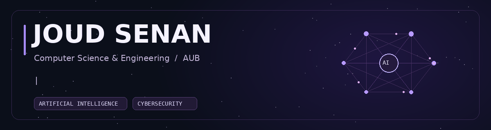

  

<h1 align="center">Hi, I'm Joud 👋</h1>

  <strong>Computer Science & Engineering Student · American University of Beirut</strong> 
  Artificial Intelligence & Cybersecurity Concentrations

  
  
  

  <a href="#-about-me">About</a> &nbsp;·&nbsp;
  <a href="#-featured-projects">Featured Projects</a> &nbsp;·&nbsp;
  <a href="#-technologies-i-work-with">Tech Stack</a> &nbsp;·&nbsp;
  <a href="#-research--earlier-work">Research</a>

  
  
  

---

### 💫 About me

I'm a fourth-year Computer Science and Engineering student at **AUB**, with a double concentration in **Artificial Intelligence and Cybersecurity**. I enjoy turning ideas into working applications, from AI agents that retrieve information and call tools to computer vision prototypes and platforms with security built into their design.

- 🤖 **Building:** multi-agent workflows, RAG pipelines, and MCP tools with LangGraph, FastAPI, and Docker.
- 🧪 **Experimenting:** PyTorch models, NLP, sparse neural networks, and evaluation of LLM applications.
- 🛡️ **Practicing:** secure authentication, access control, file-upload defenses, and application security testing.
- 🌱 **Learning:** transformers, fine-tuning, and ML pipelines through coursework and projects.
- 🌌 **Beyond the screen:** space, physics, mathematics, aerospace, and the networks that connect us.
- 🤝 **Open to:** AI engineering internships, research opportunities, and software projects where I can contribute and keep learning.

### 🚀 Featured projects

<table>
<tr>
<td width="50%" valign="top">
<h3>🌱 <a href="https://github.com/Joud158/smart-agri-copilot">Smart Agri Copilot</a></h3>

A multi-agent agriculture advisor with a LangGraph supervisor, specialist agents, a Qdrant-backed RAG pipeline, and MCP tools. Includes a separate irrigation service, Docker Compose deployment, and evaluation scripts.

Python · LangGraph · FastAPI · Qdrant · MCP · Docker

<a href="https://github.com/Joud158/smart-agri-copilot"><strong>Explore repository →</strong></a>

</td>
<td width="50%" valign="top">
<h3>🧭 <a href="https://github.com/Joud158/pathpilot-ai-c4">PathPilot AI — Custom ReAct Agent</a></h3>

A career-services assistant with a manually implemented LangGraph ReAct loop, configurable personas, validated tools, and a Gradio interface. Includes experiments comparing prompt configurations and records of tool behavior.

Python · LangGraph · Gradio · Gemini / OpenAI APIs

<a href="https://github.com/Joud158/pathpilot-ai-c4"><strong>Explore repository →</strong></a>

</td>
</tr>
<tr>
<td width="50%" valign="top">
<h3>📚 <a href="https://github.com/Joud158/campusreads-mcp-toolkit">CampusReads — MCP Toolkit</a></h3>

An agent-connected toolkit for searching a demonstration book catalog and saving persistent reading lists. Exposes typed data, action, and orchestration tools through FastMCP, with OpenAI Agents SDK integration and SQLite storage.

Python · FastMCP · OpenAI Agents SDK · Pydantic · SQLite

<a href="https://github.com/Joud158/campusreads-mcp-toolkit"><strong>Explore repository →</strong></a> &nbsp;·&nbsp; <a href="https://youtu.be/5KXVjjvgGrw">Watch demo ↗</a>

</td>
<td width="50%" valign="top">
<h3>👁️ <a href="https://github.com/Joud158/Guided_Vision">GuidedVision</a></h3>

A team-built assistive prototype that describes camera frames and delivers directional audio alerts for potential hazards. Connects a webcam or Raspberry Pi camera client to a FastAPI server running SmolVLM, with a web dashboard and Docker setup.

Python · Hugging Face Transformers · OpenCV · FastAPI · Raspberry Pi · Docker

<a href="https://github.com/Joud158/Guided_Vision"><strong>Explore repository →</strong></a>

</td>
</tr>
<tr>
<td width="50%" valign="top">
<h3>🔐 <a href="https://github.com/Joud158/PolyLab">PolyLab</a></h3>

A team-built cryptography learning platform with classroom, assignment, submission, and grading workflows. Combines role-based access, CSRF protections, and file validation with an interactive GF(2ᵐ) polynomial arithmetic engine.

FastAPI · React · TypeScript · PostgreSQL · Tailwind CSS · Docker

<a href="https://github.com/Joud158/PolyLab"><strong>Explore repository →</strong></a> &nbsp;·&nbsp; <a href="https://www.youtube.com/watch?v=tLylCZbrl5U">Watch demo ↗</a>

</td>
<td width="50%" valign="top">
<h3>🧪 <a href="https://github.com/Joud158/lottery-tickets-corrupted-supervision">Lottery Tickets Under Corrupted Supervision</a></h3>

A PyTorch reproduction of the Lottery Ticket Hypothesis on MNIST, extended to study sparse networks under noisy training labels. Compares original initialization with random reinitialization and explores pruning-mask overlap and transfer.

PyTorch · Jupyter · Iterative Magnitude Pruning · Controlled Experiments

<a href="https://github.com/Joud158/lottery-tickets-corrupted-supervision"><strong>Explore repository →</strong></a>

</td>
</tr>
</table>

### 🛠️ Technologies I work with

   
   
  

| Area | Tools and concepts used across my projects |
| --- | --- |
| AI agents & retrieval | LangGraph, MCP / FastMCP, OpenAI Agents SDK, Qdrant, FAISS, tool calling, RAG evaluation |
| Machine learning & vision | PyTorch, Hugging Face Transformers, OpenCV, Open3D, NLP, vision-language models |
| Backend & applications | FastAPI, Pydantic, React, TypeScript, SQL, REST APIs, Docker Compose |
| Security | Role-based access control, CSRF defenses, upload validation, vulnerability testing, threat modeling |
| Hardware foundations | Verilog / SystemVerilog, finite state machines, FPGA development, Vivado, RISC-V coursework |

<strong>📂 More projects and coursework</strong>

#### AI applications & retrieval

- [AgriGuard](https://github.com/Joud158/AgriGuard) — Farm monitoring, local vision-language analysis, and farmer–agronomist coordination.
- [Digital Agronomist](https://github.com/Joud158/Digital-Agronomist-RAG-Pipeline) — Document ingestion, FAISS retrieval, and Groq-powered answers with chunk citations.
- [RAG & Voice Evaluation](https://github.com/Joud158/RAG-Assignments-Document-Processing-Retrieval-and-Voice-Evaluation) — Retrieval workflows, agent tools, voice interaction, and manual evaluation.
- [PathPilot AI](https://github.com/Joud158/pathpilot-ai) — Earlier business-assistant project exploring routing, memory, lead collection, and reflection.
- [Mistral + FastAPI](https://github.com/Joud158/MistralAI_With_FastAPI_Integration) — LLM API integration developed during All-Girls Code Bootcamp 2025.

#### Machine learning & data

- [RNN, LSTM & GRU Comparison](https://github.com/Joud158/Recurrent-Neural-Networks-in-Practice) — Team experiments on AG News classification with PyTorch.
- [IMDB Sentiment API](https://github.com/Joud158/assignment4_inmind_nlp) — Sentiment-model serving with FastAPI.
- [Point Cloud Processing](https://github.com/Joud158/Inmind_PointCloud) — Open3D processing and interactive visualization.
- [Smart Business Insights](https://github.com/Joud158/Smart_Business_Insights) — Team-built retail analytics dashboard with sales metrics and LLM-assisted recommendations.
- [AlphaLabLite](https://github.com/Joud158/alphalablight_assessment) — Time-series scripting engine with dependency-based execution, SQLite persistence, a CLI, and a REST API.

#### Security, software & digital systems

- [Meridian Service Desk](https://github.com/Joud158/Meridian-App) — Software security coursework covering SQL injection, scanning, threat modeling, and fixes.
- [File Upload & Path Traversal Defenses](https://github.com/Joud158/EECE503M-Assignment2-Path-Traversal---File-Upload) — Upload validation, authorized downloads, and security regression tests.
- [Access Control & Injection Defenses](https://github.com/Joud158/eece503m-assignment3-meridian-security) — Coursework addressing access control, CSRF, privilege escalation, and command injection.
- [CTF — Theta Machine](https://github.com/Joud158/CTF-Theta-Machine) — Enumeration, exploitation, and privilege escalation in a controlled lab.
- [Ethical Hacking Notes](https://github.com/Joud158/Ethical-Hacking-I-Notes) — Study notes on penetration testing methods and tools.
- [Library Management System](https://github.com/Joud158/Library-Management-System) — Java application for library inventory, lending, and resource management.
- [Elevator Controller](https://github.com/Joud158/Elevator-Controller) — Team-built SystemVerilog FSM with direction-aware scheduling and a simulation testbench.

### 🔬 Research & earlier work

- **ChartCompleteQA / AraSTEM at AUB:** contributed to chart-comprehension research and dataset work for visual question answering.
- **StudyWise:** worked on the machine learning component of a student-assistance chatbot using a medical dataset; presented the project through the Amazon mentorship program at AUB.
- **Digital systems & networking:** additional coursework includes an RV32IF processor with a floating-point unit and AUBoutique, a network programming marketplace project.

---

### 🤝 Let’s build something useful

Interested in AI agents, applied machine learning, or secure software? [Connect on LinkedIn](https://www.linkedin.com/in/joud-senan-99245b298/) or [send me an email](mailto:jas53@mail.aub.edu).

### 📈 GitHub activity

[View my contribution calendar and recent activity on GitHub →](https://github.com/Joud158#year-list-container)

  <em>Code the stars you want to orbit. Build the gravity that pulls your dreams closer.</em>

Curiosity drives the idea. Building makes it real.

